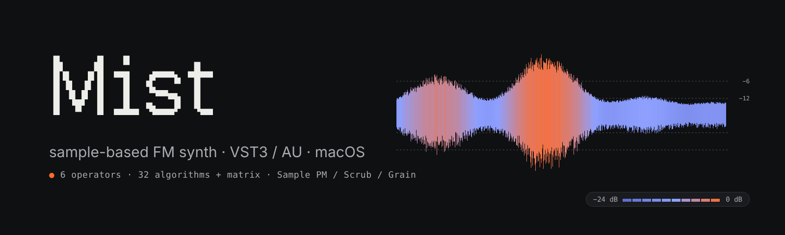
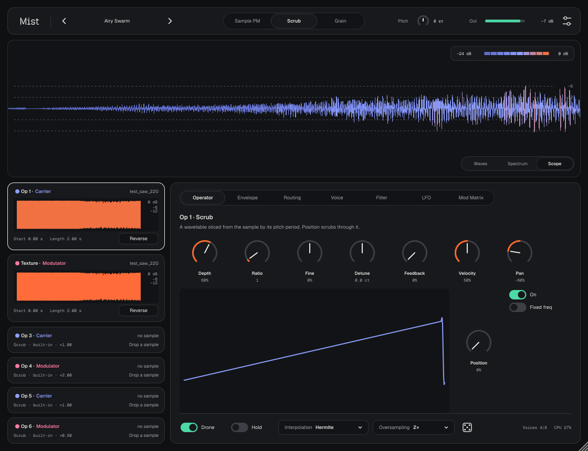
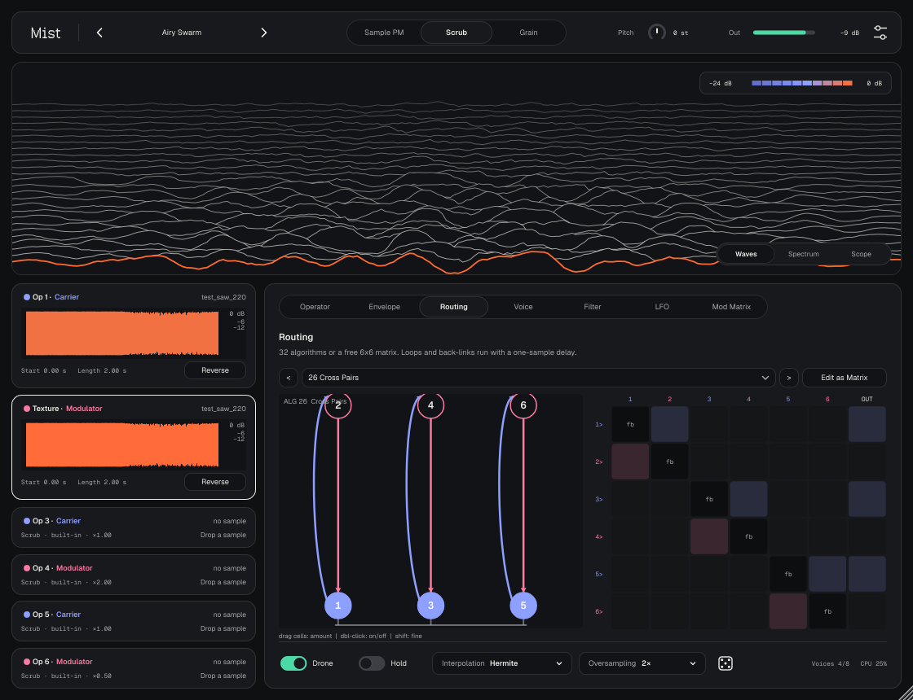
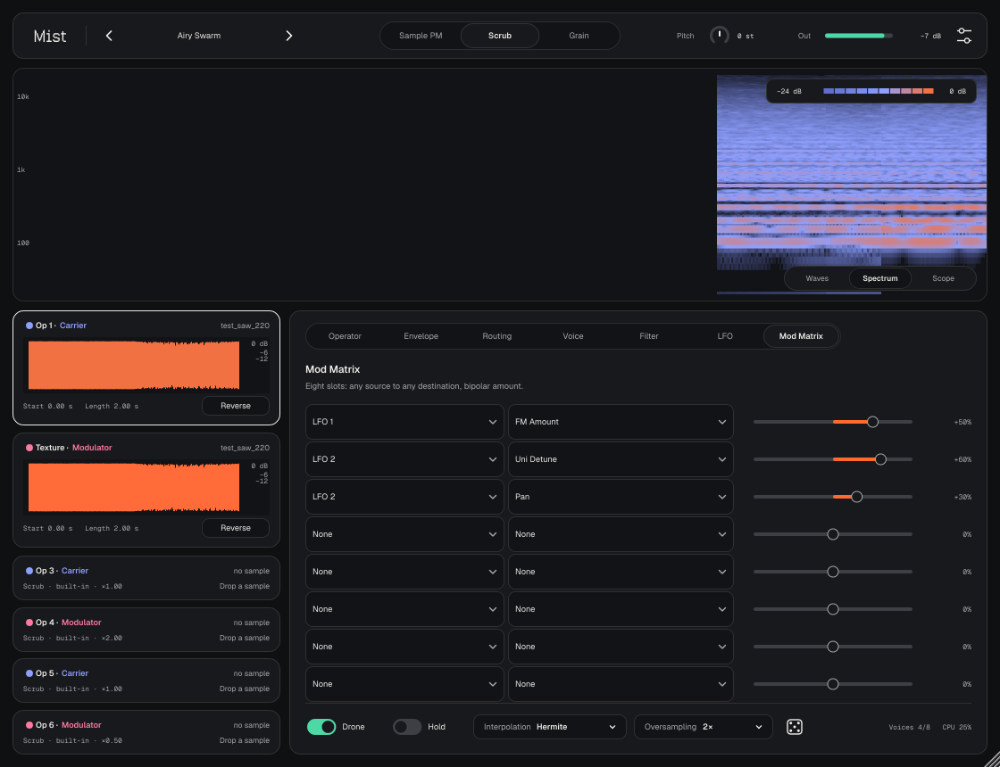
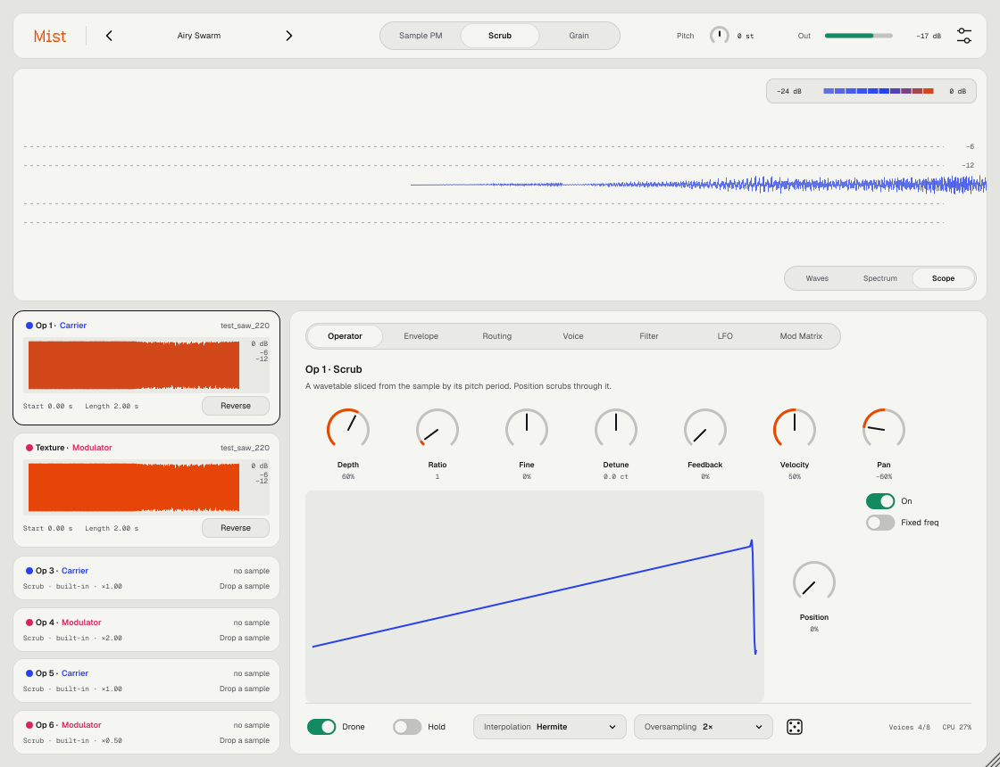

<p align="center">
  
</p>

<p align="center">
  
  
  
  
</p>

<p align="center">
  <a href="https://github.com/controloptioncommand/Mist-vst/releases/latest/download/Mist-macOS.zip"><b>⬇ Скачать Mist для macOS</b></a>
</p>

---

**Mist** — вайбкод-плагин: синтезатор на частотной (фазовой) модуляции, где вместо синусов звучат ваши семплы. 

Кидаете на оператор запись дождя, голоса, плёночного шипения или скрипки, связываете операторы в цепочку — и один семпл начинает «раскачивать» другой. Получаются дроны, пэды, металлические колокола, шевелящиеся текстуры и прочий саунд-дизайн, который трудно описать словами.

<p align="center">
  
</p>

## Что внутри

### 100 шаблонов под ваш семпл

Фактори-пресеты — это шаблоны, «формочки»: кладёте свой семпл в **Op 1** и листаете. Семпл остаётся на месте, вокруг него меняются модуляторы, огибающие, фильтр, unison и LFO. Десять характеров по десять шаблонов, характер — первое слово в названии: **Airy, Soft, Warm, Hollow, Glassy, Bright, Hard, Metallic, Dark, Moving**.

### 6 операторов, у каждого три режима

| Режим | Что делает |
|---|---|
| **Sample PM** | Семпл проигрывается, а модуляторы сдвигают точку чтения в нём, сэмпл за сэмплом. Живые, «грязные» текстуры. Есть start, петля Forward / Ping-Pong с кроссфейдом, reverse, root и keytrack. |
| **Scrub** | Из семпла нарезается wavetable на 64 кадра по найденной высоте тона. Ручка Position прокручивает по нему. Чистый тон без алиасинга — для пэдов. На графике остаются призрачные следы прошлых положений. |
| **Grain** | Перекрывающиеся зёрна из выбранного места семпла. Модуляторы изгибают каждое зерно. Ручки Size, Density, Spray — для облаков и шумных дронов. |

Без семпла оператор играет встроенную таблицу: Sine → Sine+Oct → Tri → Square → Saw → Pulse → Narrow → Formant.

Высота тона семпла определяется автоматически. Семплы хранятся **внутри** пресета и проекта Ableton (FLAC), поэтому исходные файлы можно удалить или переложить.

### Маршрутизация

- **32 алгоритма**: от классического стека до колец, перекрёстных пар и «хаоса» с обратными связями.
- Режим **Matrix**: любой оператор модулирует любой, 36 ячеек плюс отдельный выход каждого оператора. Кнопка «Edit as Matrix» переносит текущий алгоритм в матрицу.
- **Feedback** на каждом операторе.

<p align="center">
  
</p>

### Звук и модуляция

- Огибающая DAHDSR на каждом операторе, времена до 30 с. У атаки, спада и релиза есть точка изгиба: тянете — отрезок выгибается.
- 8 голосов, режимы Mono и Legato, glide, unison до 8 голосов с detune и стерео-разбросом.
- Фильтр LP12 / LP24 / BP / HP / Notch с drive, keytrack и отдельной огибающей.
- 2 LFO, 7 форм, синхронизация с темпом и транспортом Ableton.
- Mod Matrix на 8 слотов. Источники: LFO, Mod Env, Velocity, Key, Mod Wheel, Aftertouch, Random. Назначения: глобальные параметры, а также Level / Pitch / Scan / Feedback каждого оператора.
- **Drone**: ноты залипают и копятся, пока режим включён. Можно отпустить клавиши и крутить ручки.
- **Hold**: как Hold в Arpeggiator — ноты звучат после отпускания, каждое новое нажатие заменяет удерживаемые.
- **Pitch** в тулбаре: транспонирование всего звука на ±24 полутона.
- Слоты операторов можно переименовать двойным кликом по «Op N».
- Интерполяция Linear / Hermite и оверсемплинг 1× / 2× / 4× против алиасинга.
- 🎲 **Кубик**: случайный патч. Меняет алгоритм, отношения частот, огибающие, фильтр и LFO в безопасных пределах. Громкость, семплы, панораму и режимы не трогает, поэтому тишины или перегруза не будет. В настройках → Randomizer можно защитить любые группы параметров или разрешить менять режимы операторов.

### Главный вид

Три вкладки результата:

- **Scope** — плотная волна: по полоске на каждый пиксель, цвет по громкости от −24 до 0 дБ, направляющие −6 и −12 дБ.
- **Waves** — хребтовые линии, история волны «стопкой».
- **Spectrum** — спектрограмма в той же цветовой шкале.

<p align="center">
  
</p>

### Две темы

**Oxygen** — светлая, **Rubber** — тёмная. Можно следовать системной теме macOS или выбрать вручную: иконка настроек → Appearance. Один резкий оранжевый сигнальный цвет, плотные поверхности без стекла, теней и декоративных градиентов. Весь интерфейс набран шрифтами Medeo: Sans, Mono для чисел и Pixel для логотипа. Учитывается системная настройка «Уменьшить движение».

<p align="center">
  
</p>

## Установка

1. Скачайте **[Mist-macOS.zip](https://github.com/controloptioncommand/Mist-vst/releases/latest/download/Mist-macOS.zip)** и распакуйте двойным кликом.
2. Откройте Терминал и выполните:
   ```bash
   bash ~/Downloads/Mist-macOS/install-mac.sh
   ```
   Скрипт кладёт `Mist.vst3` и `Mist.component` в `~/Library/Audio/Plug-Ins` и снимает карантин macOS: плагин не подписан сертификатом Apple.
3. Перезапустите Ableton. Если Mist не появился: Settings → Plug-Ins → Rescan.

Подробное руководство — **[Mist-manual.pdf](docs/Mist-manual.pdf)**, оно же лежит в архиве релиза.

Нужен Mac на Apple Silicon и macOS 11 или новее. Каждое изменение в `main` автоматически собирается, проходит pluginval и auval и выкладывается в [Releases](https://github.com/controloptioncommand/Mist-vst/releases).

## Как пользоваться за минуту

1. Перетащите аудиофайл на карточку **Op 1**.
2. Клик по имени пресета → **Templates** → выберите характер и листайте шаблоны. Или соберите звук сами: сверху выберите режим **Sample PM**, **Scrub** или **Grain**.
3. Вкладка **Routing**: выберите алгоритм, например *24 Ring 6* для дронов.
4. Ручка **Depth** у модуляторов задаёт, насколько сильно они «гнут» несущую.
5. Включите **Drone**, сыграйте низкую ноту и отпустите.
6. Если надоело — бросьте кубик 🎲.

Пресеты лежат в `~/Music/Mist/Presets/*.mist`. Сохранить пресет: иконка настроек → Save preset.

## Сборка из исходников

```bash
cmake -B build -G Xcode
cmake --build build --config Release --target Mist_VST3 Mist_AU
```

Офлайн-тест прогоняет 100 шаблонов без семпла и с пятью разными семплами, рендерит все 32 алгоритма в WAV, проверяет NaN, перегруз и скорость, бросает кубик 40 раз и снимает скриншоты интерфейса:

```bash
cmake -B build -DMIST_BUILD_TESTS=ON && cmake --build build --target MistRenderTest
./build/MistRenderTest_artefacts/Release/MistRenderTest ./render
```

## Устройство

| Где | Что |
|---|---|
| `Source/DSP/` | Синтез: голоса, операторы, зёрна, LFO, wavetable, детектор высоты тона, огибающие, фильтр |
| `Source/Algorithms.cpp` | 32 алгоритма |
| `Source/Randomizer.cpp` | Кубик и его «безопасные» диапазоны |
| `Source/UI/` | Интерфейс, темы Oxygen / Rubber, главный вид, страница About |

Написан на C++ и [JUCE 8](https://juce.com). Логотип набран шрифтом [Medeo Pixel](https://github.com/DNFDEVS/medeo-font) (SIL Open Font License, файл лицензии — `Resources/Fonts/OFL.txt`).

<p align="center"><sub>made by nnn · vibe-coded with Claude</sub></p>
